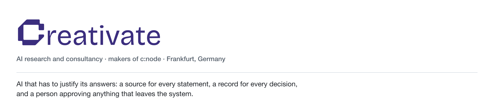
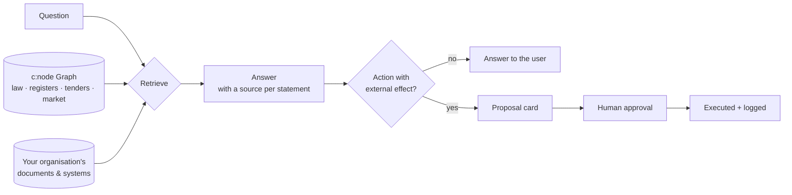
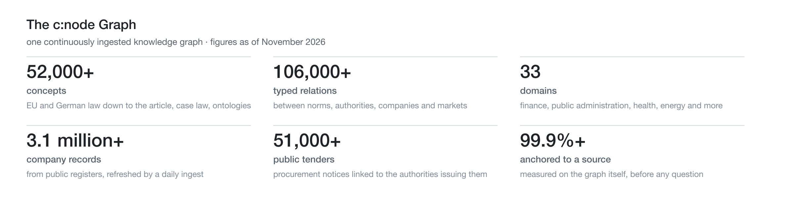
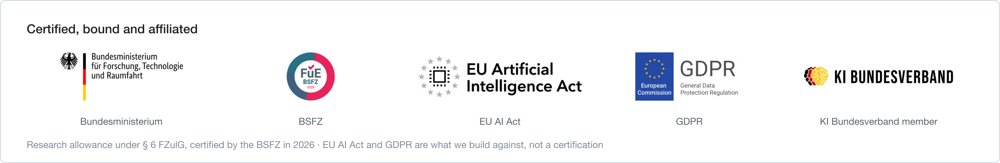

<picture>
  <source media="(prefers-color-scheme: dark)" srcset="assets/banner-dark.png">
  
</picture>

%20%C2%B7%20on--premises%20%C2%B7%20air--gapped-36C399?style=flat-square)

We are an AI research and consultancy company from Frankfurt, Germany, and the team behind
**[c:node](https://c-node.ai)**.

Our work starts from one question: **how do you build AI that has to justify its answers?** Public
administrations, banks and the German Mittelstand cannot act on "the model said so". Every statement
needs a source someone can check, every decision a record, and nothing should leave the system
without a person approving it.

## What we work on

<table>
  <tr>
    <td width="33%" valign="top">
      <h3>Evidence for knowledge</h3>
      Answers grounded in a continuously growing knowledge graph of EU and German law, public registers and market
      data — with the norm, register entry or document each statement rests on.
    </td>
    <td width="33%" valign="top">
      <h3>Evidence for action</h3>
      Agents propose, people decide. Mails, tasks and changes in connected systems stay drafts until someone
      approves them, and every decision lands in an audit trail.
    </td>
    <td width="33%" valign="top">
      <h3>Sovereign by design</h3>
      EU hosting, GDPR and the EU AI Act built in, pseudonymisation before any external model call, and an
      on-premises edition down to air-gapped setups on open-weights models.
    </td>
  </tr>
</table>

## What we have built

| | |
|---|---|
| **[c:node](https://c-node.ai)** · platform | The product: a workspace that answers from your own documents and systems plus the graph, shows the source for each statement, and holds anything with an outside effect until a person approves it. Cloud, on-premises or air-gapped. [Try it](https://try.c-node.ai) · [Graph](https://graph.c-node.ai) · an MCP server for other tools to query |
| **c:node Graph** · research core | The continuously ingested knowledge graph behind the answers — EU and German law down to the article, public registers, procurement, market data. Grown under the rules written up in [governed-graph-growth](https://github.com/CreativateLabs/governed-graph-growth). |
| **[Zulano](https://www.zulano.io)** · public sector | Applications and funding research for public services. A data mesh of more than 34 million structured records as the grounding layer, and a rule-based service that routes a request to the responsible authority deterministically rather than by a model's guess. |
| **[AI Playbook](https://ai-playbook.creativate.tech)** · self-service | A trilingual AI readiness check for organisations starting out: a questionnaire in, a report out, with the GDPR and EU AI Act obligations that apply to what they described. |
| **Whitelabel instances** · pilots | The platform runs as a separate tenant per customer — own branding, own graph, own data boundary — for municipal and enterprise pilots. |
| **Consultancy** · discovery | Where it starts for most customers: a paid discovery that establishes whether the problem is one evidence-bound AI actually solves, and what it would cost to find out. |

## How c:node answers

## The graph behind it

<picture>
  <source media="(prefers-color-scheme: dark)" srcset="assets/graph-dark.png">
  
</picture>

Live counts in the observatory at **[graph.c-node.ai](https://graph.c-node.ai)**, and the method
behind them in
**[governed-graph-growth](https://github.com/CreativateLabs/governed-graph-growth)**.

## Research

We publish **methods, not implementations**: how we evaluate, govern and grow systems that answer
with evidence, mapped to public standards so others can apply and check them.

| Publication | What it is | Cite |
|---|---|---|
| **[grounded-ai-evals](https://github.com/adminleo/grounded-ai-evals)** | A four-layer method for evaluating AI systems that answer with evidence — graph correctness, ontology hygiene, answer groundedness, baseline comparison — plus a release gate that blocks on named checks instead of a weighted mean. |  |
| **[governed-graph-growth](https://github.com/CreativateLabs/governed-graph-growth)** | A technical note on keeping a continuously ingested, provenance-first knowledge graph trustworthy as it grows: source authority tiers, identity before enrichment, rule-classed linking, schema re-validation, growth health signals. |  |

## Work with us

- **Pilots** — public administrations, financial institutions and mid-sized companies that want AI they can audit:
  start at [c-node.ai](https://c-node.ai), or [book thirty minutes](https://calendar.app.google/wKQLGVxpP1n67fZL6).
- **Research** — universities and research institutes working on grounded AI, legal knowledge graphs or human
  oversight of AI agents: we are open to joint work and co-authored publications.
- **Contact** — [contact@creativate.tech](mailto:contact@creativate.tech) ·
  [Leonardo Bornhäußer](https://github.com/adminleo), CTO

Trust is good. Evidence is better.
