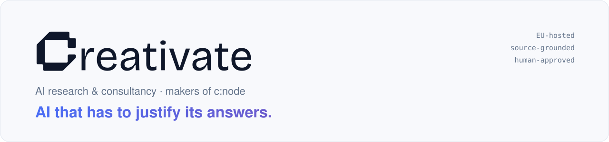
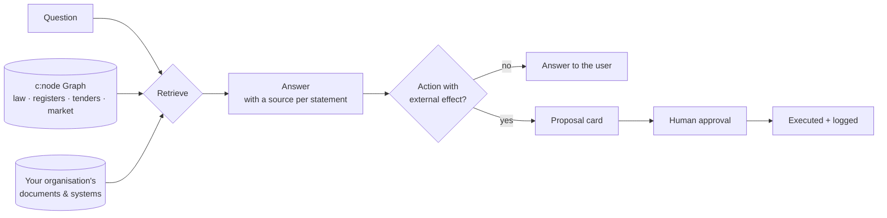

<picture>
  <source media="(prefers-color-scheme: dark)" srcset="assets/banner-dark.svg">
  
</picture>

  
  
  
  
  

We are an AI research and consultancy company from Frankfurt, Germany, and the team behind **[c:node](https://c-node.ai)**.

Our work starts from one question: **how do you build AI that has to justify its answers?** Public administrations,
banks and the German Mittelstand cannot act on "the model said so". Every statement needs a source someone can
check, every decision a record, and nothing should leave the system without a person approving it.

## What we work on

<table>
  <tr>
    <td width="33%" valign="top">
      <h3>Evidence for knowledge</h3>
      Answers grounded in a continuously growing knowledge graph of EU and German law, public registers and market
      data — with the norm, register entry or document each statement rests on.
    </td>
    <td width="33%" valign="top">
      <h3>Evidence for action</h3>
      Agents propose, people decide. Mails, tasks and changes in connected systems stay drafts until someone
      approves them, and every decision lands in an audit trail.
    </td>
    <td width="33%" valign="top">
      <h3>Sovereign by design</h3>
      EU hosting, GDPR and the EU AI Act built in, pseudonymisation before any external model call, and an
      on-premises edition down to air-gapped setups on open-weights models.
    </td>
  </tr>
</table>

## How c:node answers

## The c:node Graph at a glance

| | |
|---|---|
| **52,000+ concepts · 106,000+ relations** | EU and German law down to the article, case law, authority decisions, ontologies (EuroVoc, NACE, ELI/CELEX) |
| **3.1 million+ company records · 51,000+ public tenders** | public registers and procurement notices, refreshed by a daily ingest |
| **99.9%+ of concepts anchored to an official source** | measured on the graph itself, before any question is asked |
| **33 domains** | from finance and public administration to health and energy |

Figures as of November 2026; live counts in the public observatory at **[graph.c-node.ai](https://graph.c-node.ai)**.

## Research

We publish **methods, not implementations**: how we evaluate, govern and grow systems that answer with evidence,
mapped to public standards so others can apply and check them.

| Publication | What it is | Cite |
|---|---|---|
| **[grounded-ai-evals](https://github.com/adminleo/grounded-ai-evals)** | A four-layer method for evaluating AI systems that answer with evidence — graph correctness, ontology hygiene, answer groundedness, baseline comparison — plus a release gate that blocks on named checks instead of a weighted mean. |  |
| **[governed-graph-growth](https://github.com/CreativateLabs/governed-graph-growth)** | A technical note on keeping a continuously ingested, provenance-first knowledge graph trustworthy as it grows: source authority tiers, identity before enrichment, rule-classed linking, schema re-validation, growth health signals. |  |

## Standards we build on

  
  
  
  
  
  

## Work with us

- **Pilots** — public administrations, financial institutions and mid-sized companies that want AI they can audit:
  start at [c-node.ai](https://c-node.ai).
- **Research** — universities and research institutes working on grounded AI, legal knowledge graphs or human
  oversight of AI agents: we are open to joint work and co-authored publications.
- **Contact** — [contact@creativate.tech](mailto:contact@creativate.tech) ·
  [Leonardo Bornhäußer](https://github.com/adminleo), CTO

Trust is good. Evidence is better.
